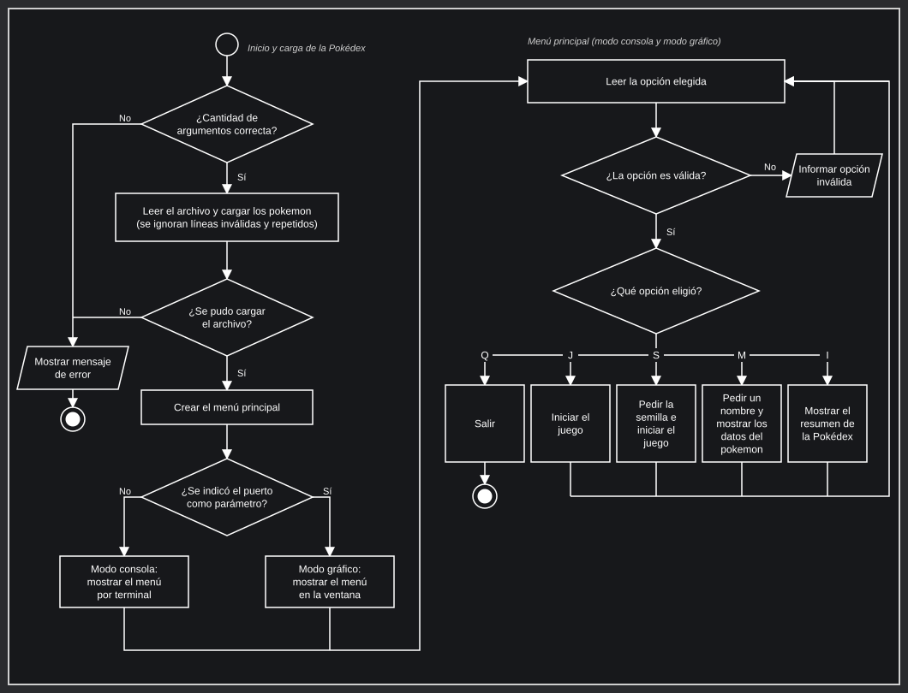

## Información del estudiante

* Matías Armida
* 114941
* armidamatias@gmail.com
* matiasnata

## Índice
* [1. Instrucciones](#1-Instrucciones)
  * [1.1. Compilar el proyecto](#11-Compilar-el-proyecto)
  * [1.2. Ejecutar las pruebas](#12-Ejecutar-las-pruebas)
  * [1.3. Ejecutar el programa con Valgrind](#13-Ejecutar-el-programa-con-Valgrind)
* [2. Funcionamiento](#2-Funcionamiento)
* [3. Estructura](#3-Estructura)
  * [3.1. Diagrama de memoria](#31-Diagrama-de-memoria)
  * [3.2. Análisis de complejidades](#32-Análisis-de-complejidades)
* [4. Decisiones de diseño y/o complejidades de implementación](#4-Decisiones-de-diseño-yo-complejidades-de-implementación)
* [5. Respuestas a las preguntas teóricas](#5-Respuestas-a-las-preguntas-teóricas)

## 1. Instrucciones

### 1.1. Compilar el proyecto
```bash
make demo
```

### 1.2. Ejecutar las pruebas
```bash
make pruebas
```

### 1.3. Ejecutar el programa con Valgrind
```bash
make valgrind-demo
```

## 2. Funcionamiento
Explicar **qué** hace el TP implementado, aclarando todas las decisiones de funcionamiento que no estaban definidas por el enunciado. Se deben incluir todos los diagramas que consideren necesarios para explicar el funcionamiento del programa.

> [!IMPORTANT]
> Es muy importante entender la *diferencia entre qué y cómo*. En esta sección **NO** se busca una explicación de cómo implementaste el programa, qué funciones usaste, en qué línea, etc.; se busca una explicación de **qué** es lo que hace el programa en líneas generales. 

> [!WARNING]
> Es importante usar diagramas para explicar los conceptos de forma clara, pero el exceso será negativo. Los diagramas deben tener un fin explicativo y, por lo general, sirven para reemplazar uno o múltiples párrafos de explicación.

## 2. Funcionamiento (EJEMPLO)
El programa recibe 7 números del usuario y una vez obtenidos todos los muestra en pantalla. Para esto define un vector estático de 7 elementos y llena el mismo con los datos que inserta el usuario; cuando termina de insertar todos los números procede a imprimirlos en pantalla.
<div align="center">
  
  <p>Diagrama de flujo del programa explicado con más detalle.</p>
</div>

## 3. Estructura

Para llevar adelante la implementación del trabajo se diseñaron y reutilizaron distintas estructuras de datos encapsuladas en sus respectivos TDAs.

#### Struct `tp1` (`tp1_t`): 
Struct `tp1` funciona como la estructura principal de almacenamiento de la Pokédex y contiene un único campo `abb_t *pokemones`, que es un puntero a un Árbol Binario de Búsqueda donde se alojan todos los pokemones leídos del archivo. Decidí que contenga únicamente este puntero ya que el propio TDA ABB se encarga internamente de gestionar la cantidad de elementos y el criterio de ordenamiento con sus respectivas primitivas.

#### Struct `abb` (`abb_t`):
Struct `abb` representa la cabecera del Árbol Binario de Búsqueda y posee tres campos: `size_t tamanio` (lleva el conteo actualizado de elementos insertados para poder consultar el tamaño del árbol en tiempo constante), `nodo_abb_t *nodo_raiz` (puntero al nodo superior desde el cual inician todas las operaciones de búsquedas, inserciones, eliminaciones y recorridos) y `abb_comparador comparador` (puntero a la función que define el criterio de orden entre elementos, indispensable para decidir hacia qué subárbol desplazarse).

#### Struct `nodo_abb` (`nodo_abb_t`):
Struct `nodo_abb` representa cada nodo individual (elemento) del árbol y contiene tres campos: `void *elemento` (puntero genérico al dato almacenado, lo que permite que el ABB sea genérico y pueda guardar cualquier tipo de estructura como `struct pokemon` en este caso), `struct nodo_abb *izquierda` (puntero al subárbol con elementos menores) y `struct nodo_abb *derecha` (puntero al subárbol con elementos mayores o iguales).

#### Struct `menu`:
Struct `menu` encapsula el TDA Menú y cuenta con el campo `lista_t *opciones`, un puntero a una lista simplemente enlazada donde se almacenan secuencialmente las opciones registradas. Delegar el almacenamiento en el TDA Lista evita reimplementar el manejo de nodos y permite mantener el orden de inserción para la navegación por índice.

#### Struct `opcion` (`opcion_t`):
Struct `opcion` representa cada comando disponible dentro del menú mediante tres campos: `char clave` (el carácter identificador normalizado en mayúscula para ejecutar la opción por teclado), `char* descripcion` (puntero a una copia en memoria dinámica del texto descriptivo de la opción) y `menu_accion_t accion` (puntero a la función callback `bool (*)(void *)` que ejecuta la lógica correspondiente al seleccionar dicha opción).

#### Struct `lista` (`lista_t`):
Struct `lista` es la estructura utilizada internamente por el menú para almacenar cada opción con su respectiva información. Dispone de tres campos: `nodo_t *inicio` (puntero al primer nodo para iniciar recorridos), `nodo_t *final` (puntero al último nodo, cuya utilidad es permitir inserciones al final de la lista en tiempo constante O(1)) y `size_t cantidad` (contador de elementos para conocer el largo de la lista en O(1)). 

#### Struct `nodo` (`nodo_t`):
Struct `nodo` conforma cada eslabón de la lista mediante dos campos: `void *dato` (puntero genérico que en el contexto del menú apunta a un `struct opcion`) y `struct nodo *siguiente` (puntero al próximo nodo de la secuencia).

### 3.1. Diagrama de memoria
Realizar un diagrama de memoria de la estructura de memoria durante la ejecución del programa, esto debe incluir el stack y el heap con las estructuras contenidas en ellos.

### 3.1 Diagrama de memoria (EJEMPLO)
<div align="center">
  
  <p>Diagrama de memoria de la estructura.</p>
</div>


### 3.2. Análisis de complejidades

#### PRIMITIVAS TP1.H:

#### `tp1_leer_archivo`:
Tiene una complejidad de **O(n log n)** en el caso promedio/óptimo y **O(n^2)** en el peor de los casos (donde n es la cantidad de pokemones en el archivo), ya que recibe la ruta del archivo y lee cada línea dinámicamente con `leer_linea`, separa y valida sus campos en tiempo proporcional al largo de la línea, verifica que el pokémon no esté repetido mediante `tp1_buscar_pokemon` y lo inserta en el ABB con `abb_insertar`. Dado que para cada uno de los n pokemones se realiza una búsqueda y una inserción en el árbol, si el ABB se mantiene balanceado cada operación cuesta O(log n) resultando en O(n log n) mientras que si el archivo de entrada está ordenado alfabéticamente el árbol degenera en una lista enlazada y cada búsqueda/inserción cuesta O(n), llevando el total a O(n^2). 

#### `tp1_cantidad`: 
Tiene una complejidad de **O(1)** ya que tiene como parámetro un puntero a `tp1_t` y simplemente delega la consulta en `abb_tamanio`, la cual devuelve directamente el campo `tamanio` almacenado en la estructura del árbol sin recorrer ningún elemento del mismo. 

#### `tp1_combinar`:
Tiene una complejidad de **O((n_a + n_b) log (n_a + n_b))** en el caso óptimo/promedio y **O((n_a + n_b)^2)** en el peor caso (siendo n_a y n_b las cantidades de pokemones de cada TDA recibido por parámetro), ya que recorre ambos árboles completos en PREORDEN mediante `abb_con_cada_elemento` y por cada elemento invoca a `copiar_pokemon`, la cual busca si el nombre ya existe en el árbol destino (`tp1_buscar_pokemon`) y de no existir lo inserta (`abb_insertar`). En un árbol balanceado cada búsqueda e inserción toma tiempo logarítmico, pero en un árbol degenerado toma tiempo lineal respecto a la cantidad de elementos acumulados.   

#### `tp1_escribir_archivo`:
Tiene una complejidad de **O(n)** (tanto en el mejor como en el peor caso) ya que recibe el TDA con n pokemones y recorre todos los nodos del ABB exactamente una vez en orden alfabético (INORDEN) utilizando `abb_con_cada_elemento`, ejecutando en cada visita la función `escribir_pokemon_en_archivo` que realiza operaciones de escritura de costo constante O(1). 

#### `tp1_buscar_pokemon`: 
Tiene una complejidad de **O(log n)** en el caso óptimo/balanceado y **O(n)** en el peor de los casos, ya que recibe el nombre a buscar y delega en `abb_buscar`, la cual desciende desde la raíz comparando alfabéticamente los nombres en cada nivel. En un árbol balanceado descarta la mitad de los elementos en cada paso (O(log n)), pero si el árbol está degenerado en forma de lista debe recorrer hasta los n nodos secuencialmente O(n).

#### `tp1_buscar_orden`: 
Tiene una complejidad de **O(n)** ya que recibe la posición n buscada y requiere realizar un recorrido INORDEN sobre el ABB avanzando nodo por nodo hasta alcanzar el n-ésimo elemento alfabético, visitando en el peor caso (cuando se pide el último elemento) la totalidad de los nodos del árbol.

#### `tp1_iterar`:
Tiene una complejidad de **O(n)** (asumiendo que la función callback `f` provista por parámetro es O(1)) ya que invoca a `abb_con_cada_elemento` en modo INORDEN, visitando cada uno de los n nodos del árbol.

#### `tp1_destruir`: 
Tiene una complejidad de **O(n)** ya que llama a `abb_destruir_todo` pasándole el destructor `destruir_pokemon`, lo que recorre recursivamente en postorden los n nodos del árbol liberando en O(1) la cadena `nombre`, la estructura `struct pokemon` y el nodo de cada elemento antes de liberar el árbol y el `tp1_t`.   

#### PRIMITIVAS MENU.H:

#### `menu_crear`: 
Tiene una complejidad de **O(1)** ya que no recibe parámetros y únicamente realiza una reserva de memoria para la estructura `menu_t` e invoca a `lista_crear`, que a su vez reserva e inicializa la cabecera de la lista en O(1).

#### `menu_agregar_opcion`:
Tiene una complejidad de **O(n)** (donde n es la cantidad de opciones cargadas en el menú) ya que primero verifica que la clave no esté repetida invocando a `lista_buscar`, la cual recorre los nodos de la lista de forma lineal en O(n), y luego crea la opción y la inserta en la última posición mediante `lista_insertar`, operación que se ejecuta en O(1) gracias al puntero `final` que mantiene la estructura `lista_t`.

#### `menu_ejecutar_clave`: 
Tiene una complejidad de **O(n)** en el peor de los casos, ya que delega la búsqueda de la clave en `lista_buscar`, la cual avanza linealmente por los punteros `siguiente` de los nodos hasta encontrar la opción coincidente (o llegar al final de la lista) y luego ejecuta su callback en O(1). 

#### `menu_ejecutar_indice`: 
Tiene una complejidad de **O(n)** en el peor de los casos ya que recibe el índice buscado y realiza una única llamada a `lista_obtener(menu->opciones, indice)`, la cual avanza desde el inicio de la lista hasta la posición pedida (tomando O(1) si es la primera opción y O(n) si es la última) para luego ejecutar su acción.

#### `menu_con_cada_opcion`:
Tiene una complejidad de **O(n)** (asumiendo un callback `f` de costo O(1)) ya que delega el recorrido en `lista_iterar`, la cual visita secuencialmente cada uno de los n nodos de la lista aplicando la función iteradora. 

#### `menu_cantidad`:
Tiene una complejidad de **O(1)** ya que recibe el puntero al menú e invoca a `lista_cantidad`, la cual retorna directamente el campo `cantidad` de la lista interna en tiempo constante.

#### `menu_destruir`:
Tiene una complejidad de **O(n)** ya que delega la liberación en `lista_destruir_todo` junto con el destructor `opcion_destruir`, recorriendo los n nodos de la lista de forma secuencial y liberando la descripción, la estructura `struct opcion` y el nodo en O(1) por cada elemento. 

## 4. Decisiones de diseño y/o complejidades de implementación

#### Elección del ABB para el almacenamiento de pokemones (`tp1`)

Para reimplementar el TDA `tp1_t` sin utilizar vectores dinámicos, tomé la decisión de emplear un **Árbol Binario de Búsqueda** ordenado alfabéticamente mediante el comparador `comparar_pokemones` (insensible a mayúsculas y minúsculas). Esta elección se justifica por dos motivos centrales:

1) **Mantenimiento del orden alfabético:** primitivas como `tp1_iterar`, `tp1_escribir_archivo` y `tp1_buscar_orden` exigen procesar o acceder a los pokemones ordenados por nombre. En un ABB, el recorrido INORDEN visita todos los elementos en orden ascendente en tiempo lineal O(n), sin necesidad de aplicar algoritmos de ordenamiento adicionales ni de desplazar elementos al insertar, como sucedía con el vector.

2) **Eficiencia en búsquedas y detección de duplicados:** tanto durante la lectura del archivo (`procesar_linea`) como en la combinación de dos estructuras (`tp1_combinar`) y en `tp1_buscar_pokemon`, se requiere verificar constantemente si un nombre ya existe. Mientras que en una lista enlazada cada búsqueda sería estrictamente O(n) en el peor de los casos, el ABB permite resolverla en O(log n) en el caso promedio.

#### Detección de repetidos y comparación de nombres

El enunciado indica que `pikachu`, `Pikachu` y `PIKACHU` son el mismo pokemon. Para cumplirlo, `comparar_nombres` compara carácter a carácter pasando cada uno a minúscula (con `tolower` sobre `unsigned char`, para evitar comportamiento indefinido con caracteres negativos). Al leer el archivo, antes de insertar cada pokemon se lo busca en el árbol: si ya existe se descarta, conservando así el primero encontrado en el archivo, como pide el enunciado. El mismo criterio se aplica en `tp1_combinar`.

#### Manejo de memoria de los pokemones

Cada `struct pokemon` se reserva de forma independiente en el heap y con una copia propia del nombre, de modo que el TDA no dependa de que quien lo usa libere la memoria por algún motivo. El ABB solo guarda punteros, por lo que la liberación se delega en `abb_destruir_todo` con un destructor que libera el nombre, el pokemon y luego el nodo. Si falla alguna reserva al agregar un pokemon, se libera lo ya reservado antes de informar el error, y si falla durante la lectura del archivo se cierra el archivo y se destruye el TDA antes de devolver `NULL`.

#### Recorrido PREORDEN en `tp1_combinar`

Al copiar los pokemones de los árboles originales hacia el nuevo árbol destino en `copiar_todos_los_pokemones`, elegí recorrer los árboles origen en PREORDEN en lugar de INORDEN. Si se recorrieran en INORDEN, los elementos se extraerían ordenados alfabéticamente y, al insertarse secuencialmente en un ABB vacío, el árbol destino degeneraría en una lista enlazada, perdiendo los beneficios mencionados anteriormente. En cambio, el recorrido PREORDEN inserta primero las raíces antes que sus subárboles, por lo que el destino conserva la forma del árbol de origen.

#### Decisiones del TDA Menú

- **Lista para las opciones:** se usó una lista para conservar el orden de inserción, que es el orden en que se muestran las opciones, y para permitir acceso por posición.

- **Claves normalizadas:** las claves se guardan en mayúscula (`toupper`), de modo que `j` y `J` ejecutan la misma opción. Por la misma razón, no se permite registrar dos opciones con la misma clave ya que `menu_agregar_opcion` devuelve `false` en el caso que suceda esa situación.

- **Descripciones copiadas:** el menú guarda una copia propia de cada descripción, para no depender de la vida útil de la cadena que se le pasa.

- **Valor de retorno de las acciones:** cada acción devuelve un `bool` que indica si el programa debe continuar (`true`) o finalizar (`false`). Una clave o índice inexistente no es un error y se ignora devolviendo `true`, para que una tecla equivocada no cierre el juego.
La única función que devuelve `false` es salir(Q), para finalizar el programa.

#### Separación entre lógica e interfaces

La lógica del TP vive en los TDAs (`tp1`, `abb`, `lista`, `menu`), y cada interfaz (`interfaz_consola` e `interfaz_grafica`) solo se ocupa de mostrar y leer datos. De esta forma, el archivo `main` se encarga únicamente de validar la cantidad de argumentos recibidos, cargar la pokedex, crear el menú, elegir la interfaz según la cantidad de parámetros y liberar la memoria.

#### Modo gráfico

El engine invoca una función por cada frame y borra la pantalla entre frames, por lo que no se puede "dibujar una vez y esperar". Por eso la interfaz gráfica se resolvió como una máquina de estados (menú, ingreso de texto, mensaje, elección de dificultad, juego y cuestionario), donde cada frame dibuja la pantalla del estado actual y procesa la entrada. Decisiones propias del juego:

- **Dificultad:** el jugador elige entre 4, 8 o 12 pokemon. El máximo de 12 surge del límite de 16 sprites por frame que tiene el engine.
- **Pokemon en pantalla:** se sortean entre los de la pokedex y cruzan la pantalla en zigzag, de izquierda a derecha o al revés, entrando de forma escalonada. Su velocidad depende de la velocidad del pokemon (`1 + velocidad / 40` píxeles por frame). Como el archivo de sprites solo trae 4 formas, la forma se asigna con `posición % 4`, por lo que puede haber formas repetidas.
- **Rareza:** como los sprites no cambian de color, cada pokemon lleva debajo una estrella cuyo color indica su rareza (gris común, azul raro, amarillo legendario).
- **Semilla:** la opción "Jugar con semilla" usa `srand` con el valor ingresado, lo que permite reproducir una misma partida. Sin semilla se usa la hora actual.
- **Cuestionario:** las respuestas son numéricas, y la correcta aparece en una posición al azar entre las 3 opciones. <!-- ACTUALIZAR mañana: pool de preguntas -->
- **Menú:** <!-- ACTUALIZAR mañana: navegación con flechas/ENTER si se agrega -->


## 5. Respuestas a las preguntas teóricas

### 5.1. Explicar los cambios realizados al TP1. Justifique cada cambio aplicado.

Respecto a la entrega original del TP1, se modificó tanto la estructura de datos principal como las correcciones de calidad de código, modularización y manejo de errores:

1) **Reemplazo del vector dinámico por un ABB (`struct tp1`)**: En la versión original del TP1, `struct tp1` almacenaba un arreglo contiguo (`struct pokemon *pokemones`, cantidad y capacidad) que se redimensionaba con `realloc` y desplazaba elementos en memoria para mantener el orden alfabético. Para cumplir con los requisitos del TP2 y aprovechar los TDAs desarrollados, reemplacé el vector por un puntero `abb_t *pokemones`, reservando cada `struct pokemon` de forma independiente en el heap e insertándolo en el árbol mediante la función de comparación `comparar_pokemones`.

2) **Chequeo exhaustivo de funciones que pueden fallar:** En el TP1, dentro de `tp1_leer_archivo`, se invocaba a `procesar_linea(linea, tp1)` ignorando su valor de retorno. Si ocurría un fallo de reserva de memoria (`malloc`) al intentar agregar un pokémon, el programa seguía leyendo el archivo en lugar de abortar y liberar los recursos. Ahora se verifica el retorno de la funcion `procesar_linea`, cerrando el archivo y destruyendo el TDA antes de retornar `NULL` e indicar el fallo. 

3) **Utilización de `calloc` para evitar líneas de código innecesarias:** En el TP1, dentro de la funcion `tp1_leer_archivo` utilizaba `malloc` para reservar memoria para la estructura `tp1_t` y luego inicializaba sus 3 campos.
En cambio en este TP, se utiliza una función auxiliar (mayor modularización) la cual utiliza `calloc`, delegando la inicialización de los campos de la estructura a la función `calloc` justamente.

4) **Modularización de la función `procesar_linea`:** Anteriormente la función auxiliar `procesar_linea` se encargaba de varias tareas. Para mejorar la lectura de la función, se delegó la tarea de separar los campos de cada pokemon a la función `separar_campos` y que `procesar_linea` únicamente se encargue de llamar a funciones auxiliares para validar los campos del pokemon (nombre,peso,velocidad,rareza) y luego llamar a la función `agregar_pokemon`.

5) **Función `tp1_combinar`:** Nuevamente se modificó la utilización de `malloc` por `calloc` a la hora de reservar memoria dinámica para la estructura `tp1_t`. Además se eliminaron los dos bloques de código para recorrer las 2 pokedex, ya que eran dos bloques de código muy similar y se modularizó llamando únicamente a la función auxiliar `copiar_todos_los_pokemones`, la cual se encarga de verificar que no haya repetidos al igual que los dos bloques anteriores.

6) **Función `tp1_escribir_archivo`:** Por un lado se eliminaron literales por constantes. Tanto el char "w" para indicar que el archivo se debe abrir en modo escritura, como los char para identificar el tipo de rareza, se eliminaron para utilizar constantes.
Además se modularizó la escritura y asignación de rareza del pokemon en la función auxiliar `escribir_pokemon_en_archivo`.
Por último se agregó el chequeo de que la cantidad de pokemones escritos sea igual a la cantidad de pokemones almacenados en la estructura. En el caso de que no se cumpla la condición significa que ocurrió un error y se retorna `NULL`.

7) **Función auxiliar `agregar_pokemon`:** Al utilizar un ABB no es necesario revisar si hay espacio suficiente para agregar un nuevo pokemon por lo que también se eliminó el código de solicitar mas memoria dinámica.

8) **Comentarios descriptivos de las funciones del `.h` en el `.c`:** Se eliminaron los comentarios de las primitivas del `tp1.h` en el `tp1.c`. Se aplicó la misma lógica para las demás bibliotecas

9) **Uso de `printf` en el código:** Se eliminaron los `printf` dentro del código de los TDA. Únicamente se utilizan dentro del `main` y en las bibliotecas de interfaz para indicar posibles errores al usuario e imprimir el menu con sus respectivas opciones. 

10) **Variables sin inicializar:** Se solucionó el problema de las funciones `velocidad_valida` y `peso_valido`, las cuales tenían ambas 2 variables sin inicializar.

11) **Separación en bibliotecas y mejor modularización:** Se extrajeron las funciones de validación (`peso_valido`, `velocidad_valida`, `rareza_valida` y `nombre_valido`) a una biblioteca aparte (`validadores`), y las funciones de lectura dinámica de archivos a su propia biblioteca (`leer_linea`), dejando `tp1.c` limpio y con una cantidad menor de funciones auxiliares.

12) **Mayor uso de constantes simbólicas (`#define`):** Se reemplazaron los literales numéricos y de caracteres presentes en el código original por constantes descriptivas como `LECTURA`, `ESCRITURA`, `CARACTER_NULO`, `SEPARADOR`, `CHAR_COMUN`, `CHAR_RARO`, `CHAR_LEGENDARIO`, `VELOCIDAD_MINIMA`, `VELOCIDAD_MAXIMA`, `PESO_MINIMO` y `BASE_DECIMAL`, mejorando la legibilidad y mantenibilidad del código.

### 5.2 Explique cómo funciona el menú y cómo abstrae el problema de la independencia de la interfaz gráfica.

El TDA Menú funciona como un **despachador de comandos** (command dispatcher) que almacena internamente una lista enlazada de opciones (`struct opcion`), donde cada opción vincula una clave alfanumérica (`char clave`), un texto descriptivo (`char *descripcion`) y un puntero a función (`menu_accion_t accion`).

La abstracción respecto a la interfaz de usuario (permitiendo que el mismo menú funcione de manera idéntica tanto en modo consola como en la interfaz gráfica provista por `engine.h`) se logra mediante tres mecanismos de diseño:

1) **Inversión de control en la visualización** (`menu_con_cada_opcion`): El TDA Menú no incluye llamadas a `printf` ni a funciones de dibujado como `engine_texto`. En su lugar, expone el iterador interno `menu_con_cada_opcion`, el cual recorre las opciones y le entrega a una función callback externa la clave, la descripción y el índice de cada ítem. Así, el modo consola simplemente le pasa un callback que imprime por terminal, mientras que el modo gráfico le pasa un callback que renderiza cada renglón en la ventana y resalta el cursor actual, sin que el menú conozca qué interfaz lo está dibujando.

2) **Doble vía de ejecución** (`menu_ejecutar_clave` y `menu_ejecutar_indice`): La consola opera habitualmente leyendo un carácter ingresado por el usuario y ejecutándolo mediante `menu_ejecutar_clave`, mientras que la interfaz gráfica permite tanto presionar la letra del atajo como desplazarse con las flechas arriba/abajo y confirmar con ENTER invocando a `menu_ejecutar_indice` con la posición seleccionada.

3) **Contexto polimórfico** (`void *contexto`): Al ejecutarse cualquier opción, el menú invoca al callback `accion(contexto)` pasándole un puntero genérico al estado de la aplicación y devuelve un booleano que indica si el programa debe seguir corriendo o finalizar (por ejemplo, al elegir la opción Q de Salir). De este modo, el menú queda totalmente desacoplado de las estructuras del juego y del motor gráfico.

### 5.3 En general, explique qué estructuras de las implementadas fueron utilizadas para implementar la lógica del TP2 y por qué.

En el TP2 usé dos estructuras: un **ABB** para guardar los pokemon y una **lista** para guardar las opciones del menú.

**ABB para los pokemon (`tp1_t`).** La pokedex necesita las siguientes operaciones: buscar por nombre, recorrer los pokemon en orden alfabético y no tener nombres repetidos. El ABB resuelve estas características de una forma eficiente.

- Lo ordené con un comparador que compara los nombres sin distinguir mayúsculas. Así `pikachu`, `Pikachu` y `PIKACHU` son el mismo elemento, como pide el enunciado.

- La búsqueda por nombre (`buscar-nombre`) aprovecha la característica de orden del árbol y descarta una rama entera en cada comparación. En cambio con un vector desordenado habría que revisar los elementos uno por uno.
- El recorrido **inorden** proporciona los pokemones ya ordenados alfabéticamente. Por eso `mostrar-todo` y `tp1_buscar_orden` no necesitan realizar un ordenamiento.

Además la utilización de un **ABB** permite no tener que verificar si hay espacio disponible a la hora de insertar un nuevo elemento ni tener que utilizar realloc.

La contrapartida es que la eficiencia depende de la forma del árbol. En promedio las operaciones son O(log n), pero esta implementación de  ABB **no se autobalancea**: si el CSV que nos proveen ya se encuentra ordenado alfabéticamente, el árbol degenera en una lista y las operaciones pasan a O(n).

**Lista para el menú (`menu_t`).** El menú guarda pocas opciones, cada una con su clave, descripción y acción. Encontré útil a la estructura lista por estas razones:

- Mantiene el **orden de inserción**, y ese orden es el que se muestra en pantalla.

- Permite acceder **por posición** (`lista_obtener`), que es lo que necesita `menu_ejecutar_indice`.

- Permite **buscar por clave** (`lista_buscar`) para `menu_ejecutar_clave` y para evitar claves repetidas al agregar una opción. La búsqueda es O(n), pero con unas pocas opciones el costo es insignificante.

- Se **recorre completa** con `lista_iterar` para que cada interfaz dibuje las opciones a su manera. 

- Crece **dinámicamente**, así que no hay un máximo de opciones.

Además, ambas estructuras quedan **encapsuladas** dentro de `struct tp1` y `struct menu`, y se las usa solo a través de sus funciones públicas. Por eso `main.c` y las interfaces (consola y gráfica) no saben qué hay adentro.